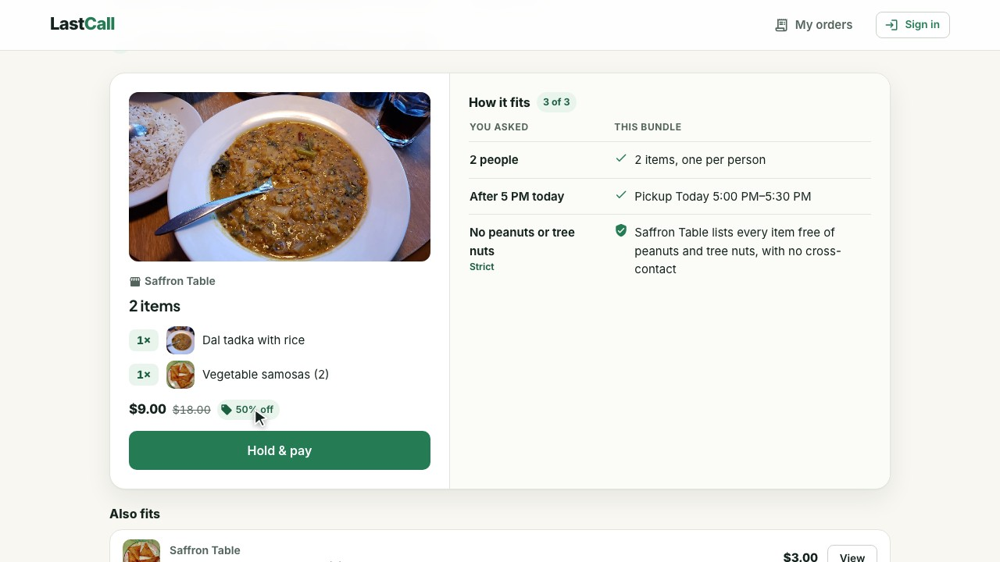
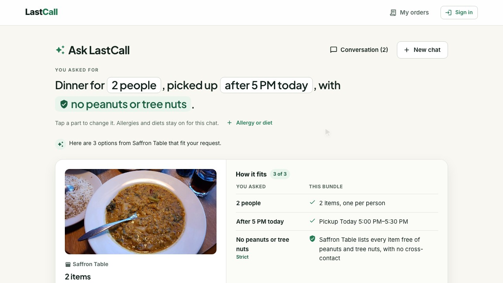
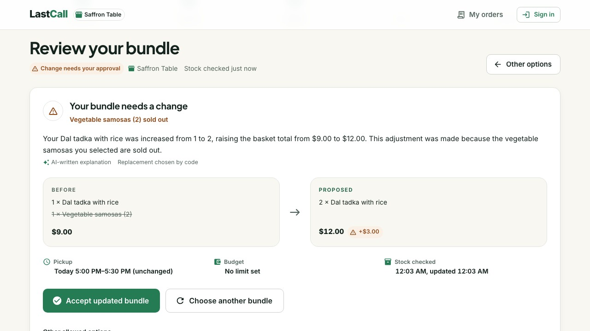
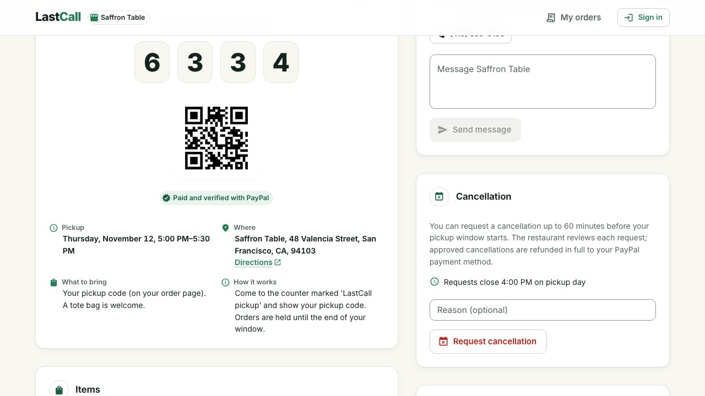
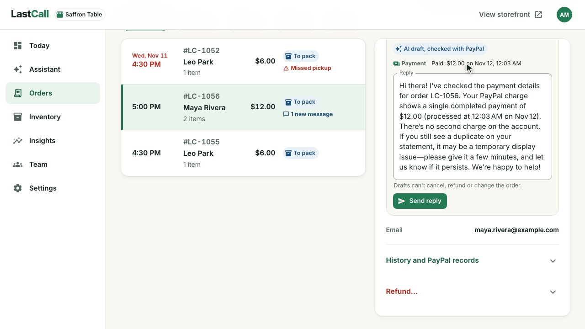
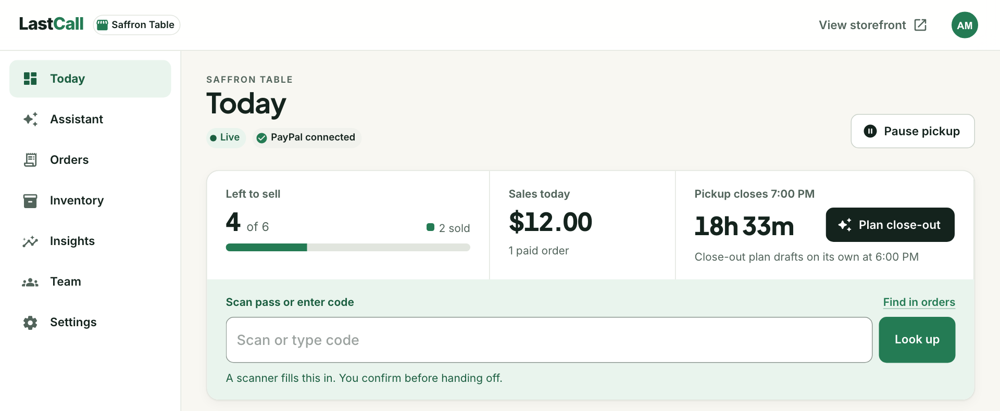
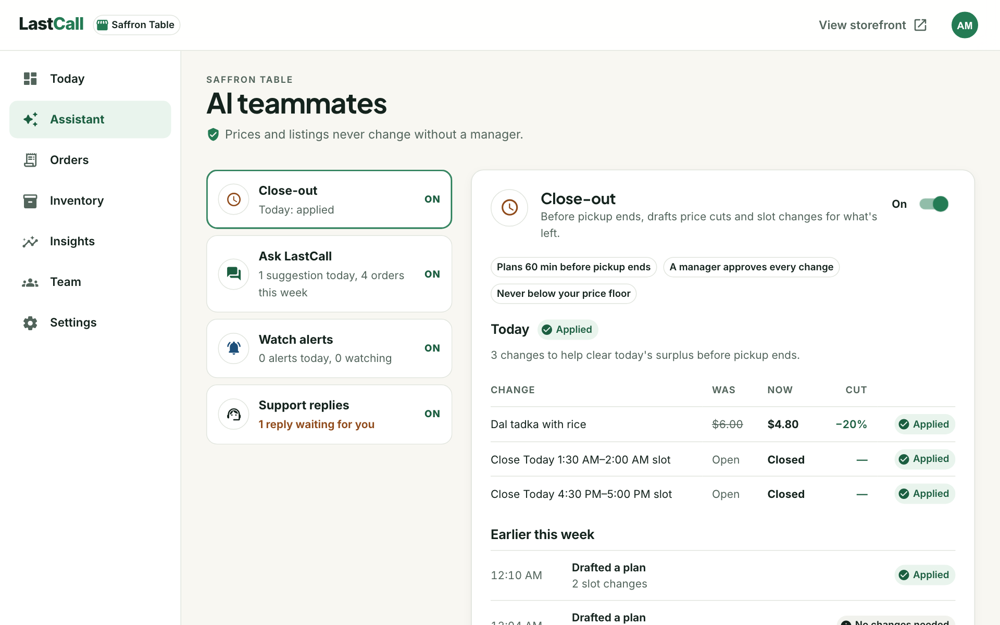
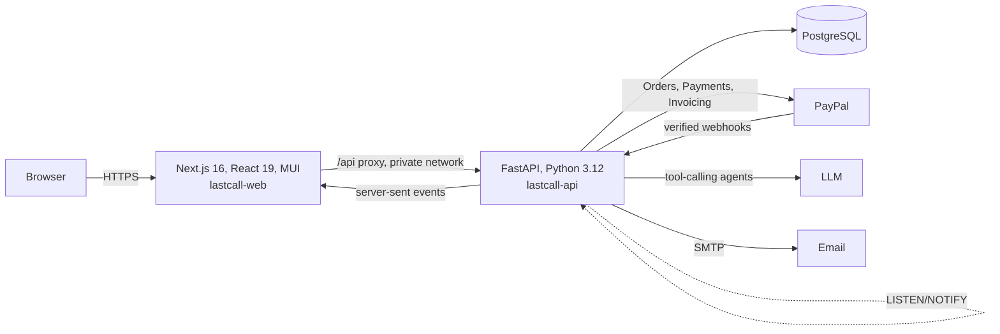

# LastCall

**Tonight's leftovers from local food shops, itemised, checked against your allergies and paid with PayPal straight to the shop.**

[](https://lastcall-web-pqo4.onrender.com)
[](https://youtu.be/fwakWJYfCAw)
[](https://github.com/nk-droid/LastCall/actions/workflows/ci.yml)
[](docs/testing.md)
[](docs/walkthrough.md)
[](LICENSE)

[](docs/paypal-integration.md)
[](docs/ai-agents.md)




> Payments run in the PayPal Sandbox (test money). The showcase shops, people and addresses are fictional.

## The problem

* **Good food is thrown away every day.** The world wasted 1.05 billion tonnes of food in 2022, and 40% of it came from restaurants, cafés and shops. Households alone wasted over a billion meals a day ([UNEP Food Waste Index Report 2024](https://www.unep.org/resources/publication/food-waste-index-report-2024)).
* **Surplus apps sell a mystery bag.** You pay first and find out what's inside at pickup, which rules them out for anyone who has to know what they're eating.
* **That's a lot of people.** About 33 million people in the U.S. have food allergies ([FARE](https://www.foodallergy.org/resources/facts-and-statistics)), and many more eat around a diet or a budget.
* **Small shops lack the time and tools** to price, list and sell what's left before close.

## How LastCall solves it

**For shoppers.** Say who you're feeding, in your own words: *dinner for 2 tonight, my partner has a severe nut allergy*. **Ask LastCall**, a shopping agent, checks every open shop's live stock, prices, pickup times and allergen records, and comes back with itemised bundles. A severe allergy is a hard rule enforced in code, and the answer shows what it left out and why. Hold the bundle, pay in PayPal's window, and collect it with a pickup code.

**For shops.** A shop sets up in minutes. Each dish has a photo, the shop's own price and the allergens it has verified, and its PayPal account is checked with PayPal before it's saved. A tablet-friendly console runs the pickup queue, refunds, team and insights. Four **AI teammates** help sell out before close, but they can't change a price or move money without a person.

**For the platform.** LastCall keeps 10% of each order's items (min $0.25), billed weekly with a PayPal invoice. Shoppers pay nothing extra. Every PayPal webhook is verified and de-duplicated, and every agent step and payment is traced.

| | |
|---|---|
|  |  |
|  |  |
|  |  |

## What's different

* **You see every item before you pay.** Bundles are built from each shop's real, live surplus, not a surprise bag.
* **Allergies fail closed.** For a strict allergy, only items the shop has verified free of that allergen, with no listed cross-contact, are offered. Anything uncertain is left out, and the shopper can see why.
* **Agents with tools, not authority.** The model talks and plans; code decides prices, stock, eligibility and every PayPal amount. Changes to a basket, a price or a pickup slot need a person's approval.
* **Paid straight to the shop.** Each shop is paid into its own PayPal business account, and refunds go back through the account that was paid.
* **Honest commerce.** No fake urgency, and savings are shown only against a shop's documented regular price.

## Built with PayPal

| PayPal API | What LastCall does with it |
|---|---|
| **Orders v2** | Creates each order on the server from LastCall's own quote, pays the shop as the payee, captures on the server and retries safely with `PayPal-Request-Id`. |
| **Payments v2** | Refunds through the shop's own account (`PayPal-Auth-Assertion`), and live lookups of captures and refunds for the support agent and for reconciliation. |
| **Invoicing v2** | Sends each shop a weekly invoice for LastCall's fee, reduced by refunds. |
| **Webhooks** | Verifies every event's signature, de-duplicates it and matches it to its payment, including refunds made outside LastCall. |
| **Merchant verification** | Checks a shop's PayPal merchant ID with PayPal before saving it. Log in with PayPal can be turned on as an alternative. |

A capture whose response is lost or times out becomes `OUTCOME_UNKNOWN` and is resolved by asking PayPal, so a shopper is never charged twice and an order is never confirmed without a verified capture. Platform ops can inject these failures on purpose. Details: [docs/paypal-integration.md](docs/paypal-integration.md).

## AI agents

| Agent | What it does | What it can't do |
|---|---|---|
| **Ask LastCall** | Understands a request, searches every open shop's live stock with the bundle engine, ranks and explains bundles. | Drop an allergy or diet, offer an item the shop hasn't listed, or set a price. |
| **Close-out** | Drafts price cuts and slot changes for what's left before close. | Cut below the price floor (30% of the regular price) or apply anything without a manager. |
| **Watch alerts** | Picks which new bundle to email a shopper who asked to be told. | Hold stock or pay. |
| **Support replies** | Drafts a reply to a shopper's message, looking the payment and any refund up with PayPal when it's about money. | Send it: staff review and send. |

Every model output is schema-validated and cross-checked, rejected tool calls are sent back to the agent to correct, a slow turn is retried once, and every agent falls back to plain rules if the model is unavailable. Each run, tool call and model turn is traced in Platform ops. Details: [docs/ai-agents.md](docs/ai-agents.md).

## Try it

The [walkthrough](docs/walkthrough.md) covers the shopper, shop and platform views in about ten minutes. In short:

1. Open the [live app](https://lastcall-web-pqo4.onrender.com). **Night Owl Doughnuts takes pickups around the clock**; the other shops open in the afternoon and evening, Pacific time.
2. Ask for something, choose **Hold & pay**, and pay in PayPal's window with **Debit or Credit Card** and a test card from [PayPal's card generator](https://developer.paypal.com/tools/sandbox/card-testing/).
3. Sign in as shop staff (credentials in the submission notes) to mark the order ready, hand it over with the pickup code, refund it or answer a message.

## Architecture



* The browser only talks to the Next.js origin, which proxies `/api` to the API, so cookies are first-party and no secret reaches the client.
* PostgreSQL is the system of record: money in integer minor units, an append-only audit log enforced by a trigger, and a durable job queue run by an in-process worker.
* Every change to an order, a stock lot or a hold emits a `NOTIFY`, which reaches open pages over server-sent events.
* **Sponsor tools:** everything is deployed on **Render** (web app, API and PostgreSQL from one [`render.yaml`](render.yaml) blueprint), and shop settings use the **Bryntum Scheduler** to show the week's opening hours, pickup windows and each slot's bookings as a timeline.

Details: [docs/architecture.md](docs/architecture.md). The rules that protect shoppers and shops, and the tests that enforce them: [docs/safety-and-trust.md](docs/safety-and-trust.md).

## Run it locally

You need Python 3.12 with [uv](https://docs.astral.sh/uv/), Node 20.9+, a PayPal Sandbox REST app, and optionally an [Ollama API key](https://ollama.com/settings/keys) (without one, the agents run on their plain rules).

```bash
cd backend && cp .env.example .env        # add PAYPAL_CLIENT_ID and PAYPAL_CLIENT_SECRET (and OLLAMA_API_KEY)
uv sync
SHOWCASE_PASSWORD=choose-a-password uv run python -m app.cli seed-showcase
uv run python -m app.cli create-admin --email you@example.com
uv run uvicorn app.main:app --port 8787     # embedded PostgreSQL if DATABASE_URL is unset

cd ../frontend && npm install && npm run dev   # http://localhost:3787
```

Deploying to Render, environment variables and PayPal app setup: [docs/deployment.md](docs/deployment.md).

## Tests

```bash
cd backend && uv run pytest                  # 262 tests on real PostgreSQL, acceptance tests AT-01 to AT-15
cd frontend && npm run lint && npm run typecheck && npm run build
cd frontend && E2E_SHOWCASE_PASSWORD=... npx playwright test   # browser journeys with a real Sandbox payment and accessibility scans
```

What each acceptance test covers, the PayPal stand-in and CI: [docs/testing.md](docs/testing.md).

## Scope and limits

* PayPal runs in the Sandbox; the API host is fixed so test credentials can never move real money.
* Pickup only, one shop per basket, USD.
* LastCall's fee is invoiced weekly rather than split off at checkout, because taking a platform fee inside the payment needs PayPal partner onboarding.
* Before selling real food: local food-sale, labelling, allergen and consumer-protection review.

## License

[MIT](LICENSE)
