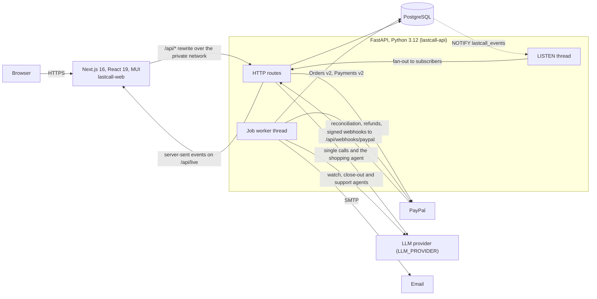
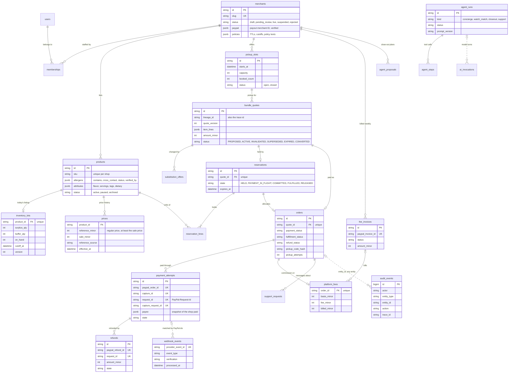
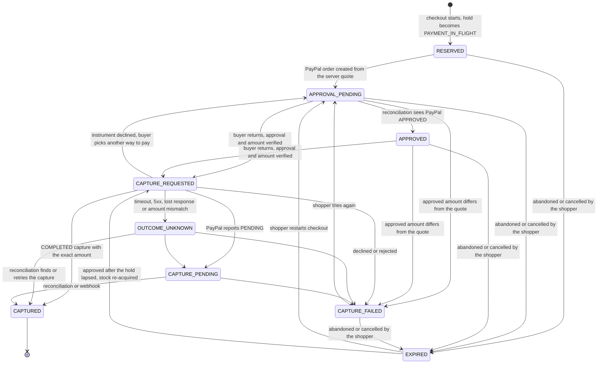
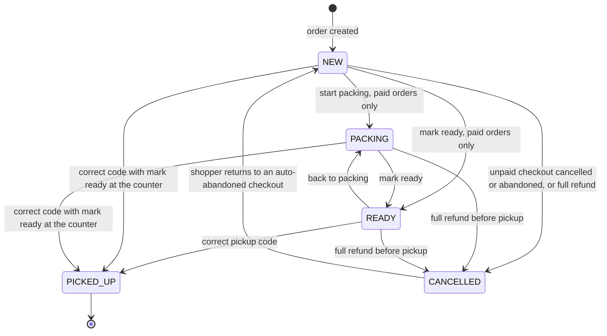
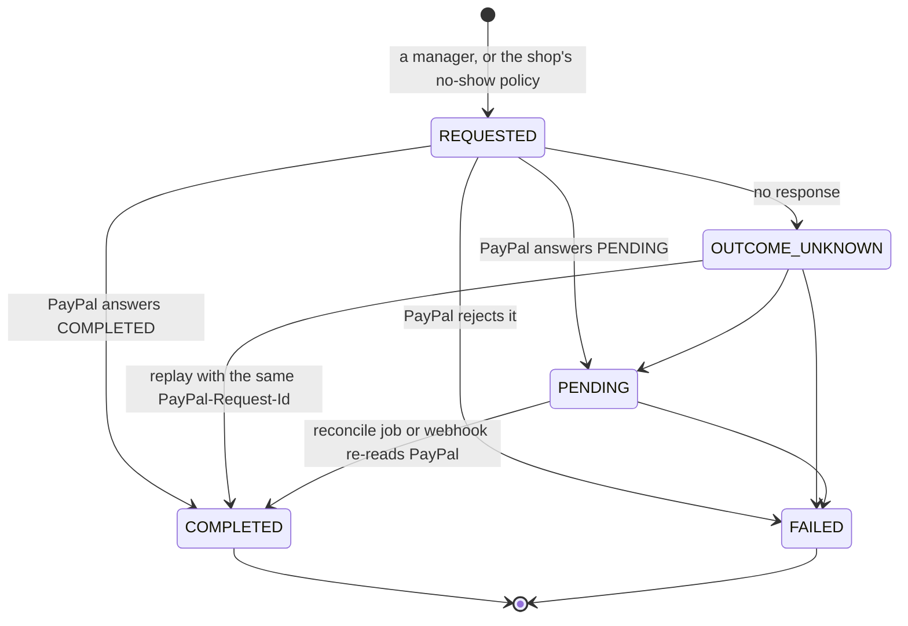
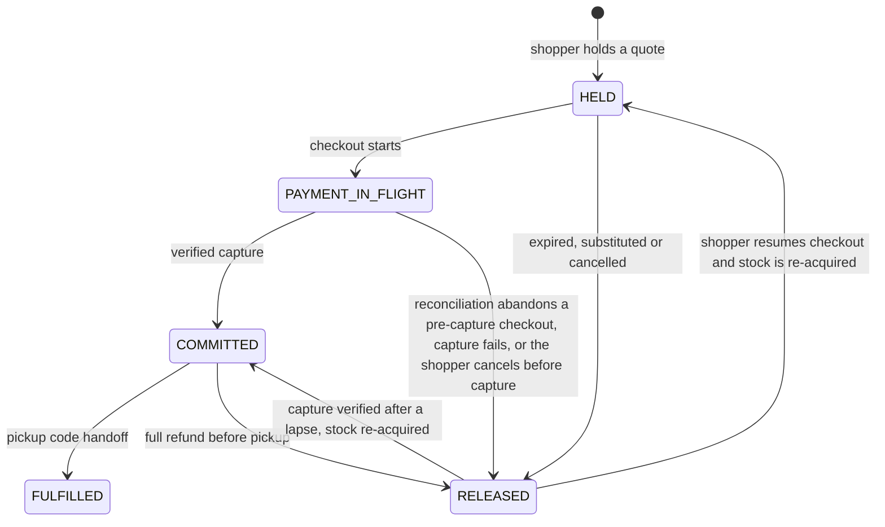

# Architecture

LastCall is two services and a database: a Next.js web app, a FastAPI API and PostgreSQL. PostgreSQL is the system of record for stock, money, payment state, jobs and the audit log. PayPal moves the money, a model helps with language, and SMTP sends email.

Related: [AI agents](ai-agents.md), [safety and trust](safety-and-trust.md).

## System



* **Web** ([`frontend/`](../frontend/)): every page and every `/api/*` call is served from one origin. [`next.config.ts`](../frontend/next.config.ts) rewrites `/api/:path*` to the API: on Render over the private network (`LASTCALL_API_HOSTPORT`), locally to `LASTCALL_API_URL` (default `http://127.0.0.1:8787`).
* **API** ([`backend/app/`](../backend/app/)): FastAPI with SQLAlchemy 2 and psycopg 3. One process runs the HTTP routes, the background job worker (unless `WORKER_ENABLED=false`, in which case [`app/worker.py`](../backend/app/worker.py) runs it as its own process) and one `LISTEN` connection for live updates.
* **Database**: PostgreSQL 16 on Render. Without `DATABASE_URL`, local development starts an embedded PostgreSQL under `backend/.data/pg`. Alembic migrations ([`backend/alembic/versions/`](../backend/alembic/versions/)) run as a pre-deploy step on Render, or on startup (`AUTO_MIGRATE`) serialized with an advisory lock.
* **PayPal**: the API host is fixed to the PayPal Sandbox in this build ([`payments/sandbox.py`](../backend/app/payments/sandbox.py)). Webhooks reach the API's own public URL.
* **Money** is stored in integer minor units (cents) everywhere ([`money.py`](../backend/app/money.py)).

## Request path and auth

1. The browser calls `/api/...` on the web origin. Next.js forwards it to FastAPI. Cookies are first-party and no API secret reaches the client.
2. FastAPI middleware ([`main.py`](../backend/app/main.py)) assigns a correlation ID (from `x-request-id` or new), blocks cross-site `POST`, `PUT`, `PATCH` and `DELETE` whose `Origin` or `Referer` isn't an allowed origin (PayPal webhooks are exempt and verified by signature instead), adds security headers and `Cache-Control: no-store`, and records metrics.
3. Dependencies in [`api/deps.py`](../backend/app/api/deps.py) resolve who is calling:

| Cookie | Who | Lifetime | Owns |
|---|---|---|---|
| `lc_sid` | Every visitor, signed in or not | 30 days | Baskets, quotes, holds and guest orders, so a guest can check out |
| `lc_auth` | A signed-in person | 14 days | The account session: shopper features (watches, alerts), shop consoles, Platform ops |

Both are `HttpOnly`, `SameSite=Lax` and `Secure` over HTTPS. Session, invite, reset and order-link tokens are random and stored only as an HMAC under `SECRET_KEY` ([`security.py`](../backend/app/security.py)). Passwords use argon2id; five failed sign-ins lock an account for 15 minutes, stored in the database so it holds across instances.

**Roles** ([`services/access.py`](../backend/app/services/access.py)) are per shop membership, plus a platform flag on the user:

| Role | Can |
|---|---|
| `staff` | Count stock, pack orders, hand them off with the pickup code, read close-out plans and AI teammates |
| `manager` | Also products, prices, allergen data, refunds, settings, inviting staff, applying close-out plans, product copy drafts |
| `owner` | Also taxes and fees, the PayPal payout account and managing managers |
| platform admin | Platform ops (`/api/ops/*`): shop review, payments, revenue, webhooks, AI calls, jobs, email, failure injection, audit log |

A guest reaches their order through their shopper session, the access token returned at checkout (stored hashed), the HMAC-derived link in their email, or, if signed in, their account. Rate limits are sliding windows per client address, kept per API instance.

## Data model

Every shop-owned row carries `merchant_id`. Models are in [`backend/app/models/`](../backend/app/models/).



Solid lines are foreign keys; dotted lines are lookups by id without a foreign key. Other tables:

| Area | Tables |
|---|---|
| Accounts | `users`, `user_sessions`, `memberships`, `invites`, `password_resets` |
| Shopping | `customer_intents` (parsed requests, redacted text), `bundle_proposals` (engine output, excluded items and reasons) |
| Stock history and alerts | `inventory_events`, `merchant_alerts`, `analytics_events`, `metric_snapshots` |
| Agents | `agent_conversations` (Ask LastCall chats), `watches`, `watch_matches` |
| Platform | `jobs`, `system_state` (worker heartbeat, PayPal check, counter lock-outs), `email_outbox`, `assets` (photos), `fault_injections` |

Quotes are immutable: a changed basket is a new quote version in the same lineage, and the old one becomes `SUPERSEDED`. Prices are append-only; the newest effective row is current.

## State machines

An order keeps payment, fulfillment and refund as three separate fields. Packing and handoff require `payment_status = CAPTURED`.

### Payment

`orders.payment_status`, driven by [`services/checkout.py`](../backend/app/services/checkout.py). Each PayPal attempt has its own `payment_attempts.state` with the same names plus `CREATING` and `VOIDED`.



* The PayPal order is built from the server's quote, never from amounts the browser sends.
* The new state and its `PayPal-Request-Id` are committed before each PayPal call, and no database transaction is held open across a network call.
* `CAPTURED` is set only from a `COMPLETED` capture whose amount and currency match the attempt. A mismatch after capture goes to `OUTCOME_UNKNOWN` with a high-severity alert.
* `OUTCOME_UNKNOWN` is resolved by looking up the original PayPal order; a retry reuses the same `capture_request_id`, so it can't charge twice (AT-07).
* The column comment also lists `QUOTED`; orders are created at `RESERVED`, since the quote phase lives on `bundle_quotes`.

### Fulfillment

`orders.fulfillment_status`, driven by [`services/fulfillment.py`](../backend/app/services/fulfillment.py).



A missed pickup is never marked collected. The `pickups.expire` job flags it (`pickup_expired_at`) and alerts the shop; with the shop's `auto_refund` no-show policy it also requests a refund.

### Refund

`refunds.state`, driven by [`services/refunds.py`](../backend/app/services/refunds.py). The order's `refund_status` follows it: `NONE`, `REQUESTED`, `PENDING` (also shown while the outcome is unknown), `COMPLETED` or `FAILED`.



Refunds go through the attempt's snapshotted payee with `PayPal-Auth-Assertion`, so they always use the account that was paid. Only one refund per order can be in progress, and the amount can't exceed what was captured minus what was refunded. A completed refund reduces LastCall's fee on the order.

### Holds

`reservations.state`, driven by [`services/reservations.py`](../backend/app/services/reservations.py), [`holds.py`](../backend/app/services/holds.py) and checkout.



## Concurrency rules

**Availability is derived, never counted.** From [`services/catalog.py`](../backend/app/services/catalog.py):

```
available = surplus_qty - active holds - paid but not handed off - buffer_qty
```

Active holds are `HELD` rows that haven't expired plus every `PAYMENT_IN_FLIGHT` row (which never lapses on its own). Paid-not-handed-off is `COMMITTED`. All of it is summed from `reservation_lines`, so there are no counters to drift. Items past their pickup cutoff have nothing available.

**Holds are all or nothing.** `reservations.acquire` locks the inventory lot rows of every product in the quote with `SELECT ... FOR UPDATE`, always in product-id order so concurrent writers can't deadlock, recomputes availability under the lock and re-validates every line (stock, per-item and per-order limits, pickup cutoff, the quote's allergen and diet constraints, unchanged price). It then locks the pickup slot row and books it within capacity. Two buyers racing for the last unit serialize, and the second sees zero (AT-03 runs 6 and 8 concurrent buyers against real row locks).

**Hold timers.** A hold lasts `reservation_ttl_seconds` (default 600). Starting checkout moves it to `PAYMENT_IN_FLIGHT` and extends it by `payment_window_seconds` (default 900). Quotes last `quote_ttl_seconds` (default 900). Each is a per-shop policy with bounds.

**A hold with payment in flight is never released blindly.** The `holds.sweep` job releases only expired `HELD` rows. For an expired `PAYMENT_IN_FLIGHT` hold, `payments.sweep` queues reconciliation instead, and `_abandon` releases stock only if the attempt is still before capture (`CREATING`, `APPROVAL_PENDING`, `APPROVED` or `CAPTURE_FAILED`). If a capture is verified after a lapse, stock is re-acquired; if it can't be, the order is flagged `stock_shortage_after_capture` and the shop is alerted to substitute or refund (AT-09).

**Stock edits respect holds.** A stock edit takes the same lot lock, refuses to go below held plus paid units (`409 held_stock`), and checks the version the editor loaded (`409 version_conflict`). Every stock or price change bumps the lot's `version`, which is also how close-out detects a product that changed after its plan.

**Idempotency everywhere money moves.** Webhook events insert with `ON CONFLICT DO NOTHING` on PayPal's event id; payment attempts, captures and refunds carry unique `PayPal-Request-Id`s; fee accrual is unique per order; jobs have dedupe keys.

## Durable job queue and worker

[`services/jobs.py`](../backend/app/services/jobs.py) keeps jobs in the `jobs` table, so they survive restarts.

* **Claiming.** A worker claims the oldest due job with `SELECT ... FOR UPDATE SKIP LOCKED`, so several workers or API instances can run side by side without taking the same job.
* **Retries.** A handler that raises `RetryLater` (for example PayPal unreachable) or fails is retried with backoff of `min(300, 2^attempts)` seconds, up to `max_attempts` (default 8), then marked `dead`. Jobs stuck `running` for 5 minutes are reclaimed.
* **Periodic jobs** register with `@handler(kind, every=seconds)` and are enqueued once per interval bucket under a dedupe key, so scaling out never runs the same tick twice.
* **Heartbeat.** Each batch writes `worker_heartbeat` to `system_state`; `/api/health` reports the worker as degraded after 60 seconds without one.
* The in-process worker polls every `WORKER_INTERVAL_SECONDS` (default 2). Platform ops lists jobs and the periodic schedule, and can run due jobs on demand.

| Job | Every | What it does |
|---|---|---|
| `holds.sweep` | 15 s | Releases expired `HELD` holds; expires quotes abandoned for over an hour |
| `payments.sweep` | 15 s | Queues reconciliation for expired in-flight holds and for any attempt in `CAPTURE_REQUESTED`, `OUTCOME_UNKNOWN` or `CAPTURE_PENDING` |
| `email.deliver` | 30 s | Sends queued email over SMTP, or marks it skipped when SMTP isn't configured |
| `pickups.expire` | 60 s | Flags paid orders past their pickup window plus grace; requests a refund if the shop's policy is `auto_refund` |
| `inventory.monitor` | 60 s | Alerts on stale stock counts, low stock and unsold surplus past its cutoff |
| `watches.scan` | 120 s | Watch alerts (A2); also queued 15 s after a relist or new stock |
| `closeout.plan` | 5 min | Starts each shop's close-out plan (A3) at its lead time; expires plans after pickup ends |
| `listings.relist` | 5 min | Publishes each shop's daily listing once its relist time (default 06:00 local) has passed |
| `analytics.aggregate` | 5 min | Snapshots today's insight metrics per shop |
| `pickup.ensure_slots` | 10 min | Generates upcoming pickup slots for live shops |
| `fees.sync` | 15 min | Re-reads open fee invoices from PayPal |
| `paypal.check` | 30 min | Checks the PayPal connection for health and the console |
| `fees.invoice` | 1 h | Invoices each shop's unbilled fees accrued before Monday 00:00 in its time zone, so a week's fees are billed once that week ends |
| `retention.purge` | 1 h | Removes customer contact details from finished orders after `data_retention_days` (default 30) |
| `jobs.cleanup` | 1 h | Deletes finished jobs older than a day |

Queued on demand: `payments.reconcile`, `refunds.reconcile`, `refunds.auto_no_show`, `webhooks.process` (after a verified webhook is stored) and `support.draft` (A4).

## Live updates

[`backend/app/realtime.py`](../backend/app/realtime.py), [`api/live.py`](../backend/app/api/live.py), [`frontend/src/lib/use-live.ts`](../frontend/src/lib/use-live.ts).

* **Publishing is automatic.** A SQLAlchemy `after_flush` hook emits `pg_notify` on channel `lastcall_events` for every changed order, hold or inventory lot. PostgreSQL delivers it only if the transaction commits, so no service has to remember to announce anything.
* **Topics:** `order:<id>` (payment, fulfillment or refund state), `shop:<id>:orders` (the shop's queue), `shop:<id>:stock` (availability).
* **Fan-out.** One `LISTEN` thread per API process hands each notice to that process's subscribers, so every instance sees every change.
* **Streaming.** `GET /api/live?topics=...` authorizes each topic up front with the same rules as the matching read endpoint (at most 6 topics) and streams server-sent events with a 15-second heartbeat.
* **Clients re-fetch.** Events carry only the topic. The browser waits 250 ms to batch bursts, then re-fetches through the normal authorized endpoint. Polling stays as the fallback.

## Photo storage

[`services/media.py`](../backend/app/services/media.py), table `assets`.

* Render's filesystem is ephemeral, so photos live in PostgreSQL.
* Uploads up to 8 MB and 40 megapixels; JPEG, PNG, WebP, HEIC or MPO. Each file is decoded and verified, rotated by its EXIF orientation, converted to RGB and re-encoded to WebP at up to 1600 px plus a 480 px thumbnail. Re-encoding strips EXIF and GPS metadata.
* Assets are immutable and de-duplicated per owner by SHA-256. They are served from `/api/assets/{id}` with an ETag and a one-year immutable cache.
* A product's photo must be an asset its own shop uploaded (or a bundled showcase photo), and products without a photo are hidden from shoppers.

## Observability

| What | Where |
|---|---|
| JSON logs | One line per request with method, path, status and latency; `correlation_id` from `x-request-id`; `trace_id` set to the quote lineage, so one basket's quote, hold, payment and handoff share it. Emails and phone numbers are redacted from every log line ([`observability.py`](../backend/app/observability.py)). |
| Health | `GET /api/health/live` (process up); `GET /api/health` (database, migration revision, worker heartbeat, PayPal configured). It returns 503 only when the database is down; other problems report `degraded`. |
| Metrics | `GET /api/metrics` in Prometheus text format, bearer `METRICS_TOKEN` (hidden in production without one). Counters for HTTP requests and latency, model calls, agent runs, jobs, webhooks and blocked cross-site requests. Kept in memory per process. |
| Platform ops | [`frontend/src/app/ops/`](../frontend/src/app/ops/): Shops, Payments (attempts with a Reconcile button), Revenue, Webhooks (verification and processing result; `POST /api/ops/webhooks/{id}/replay` re-processes one), AI calls (agent run timelines and model calls), Jobs (with Run due jobs now), Emails (metadata only, since bodies carry secret links), Failure injection (lost capture response, capture timeout, declined instrument; only when `OPS_FAULTS_ENABLED`), Audit log. `GET /api/ops/trace/{trace_id}` lists one basket's audit events in order. |
| Audit log | `audit_events` is append-only: a trigger rejects `UPDATE` and `DELETE` (migration [`0001_foundation.py`](../backend/alembic/versions/0001_foundation.py)). Metadata is redacted before it is written. |
| Shop side | Each order's detail shows its payment attempts, refunds, PayPal ids and audit timeline. |

## Code map

| Area | Files |
|---|---|
| Web app pages | [`frontend/src/app/`](../frontend/src/app/) (shopper pages, `merchant/` console, `ops/` Platform ops) |
| Proxy and security headers | [`frontend/next.config.ts`](../frontend/next.config.ts) |
| API app, middleware, routers | [`backend/app/main.py`](../backend/app/main.py), [`backend/app/api/`](../backend/app/api/) |
| Settings | [`backend/app/config.py`](../backend/app/config.py) |
| Accounts, sessions, roles, invites | [`services/accounts.py`](../backend/app/services/accounts.py), [`team.py`](../backend/app/services/team.py), [`access.py`](../backend/app/services/access.py), [`api/deps.py`](../backend/app/api/deps.py), [`security.py`](../backend/app/security.py) |
| Models and migrations | [`backend/app/models/`](../backend/app/models/), [`backend/alembic/versions/`](../backend/alembic/versions/) |
| Shops, onboarding, payouts | [`services/shops.py`](../backend/app/services/shops.py), [`payouts.py`](../backend/app/services/payouts.py), [`payments/payee.py`](../backend/app/payments/payee.py) |
| Catalog, stock, pickup slots, daily listings | [`services/catalog.py`](../backend/app/services/catalog.py), [`inventory.py`](../backend/app/services/inventory.py), [`pickup.py`](../backend/app/services/pickup.py), [`listings.py`](../backend/app/services/listings.py) |
| Dietary rules and the intent contract | [`backend/app/domain.py`](../backend/app/domain.py) |
| Request parsing, bundle engine, bundles, substitutions | [`services/intent.py`](../backend/app/services/intent.py), [`feasibility.py`](../backend/app/services/feasibility.py), [`recommendation.py`](../backend/app/services/recommendation.py), [`substitution.py`](../backend/app/services/substitution.py) |
| Quotes and holds | [`services/quotes.py`](../backend/app/services/quotes.py), [`reservations.py`](../backend/app/services/reservations.py), [`holds.py`](../backend/app/services/holds.py) |
| Checkout, reconciliation, webhooks, refunds | [`services/checkout.py`](../backend/app/services/checkout.py), [`webhooks.py`](../backend/app/services/webhooks.py), [`refunds.py`](../backend/app/services/refunds.py), [`backend/app/payments/`](../backend/app/payments/) |
| LastCall's fees and invoices | [`services/fees.py`](../backend/app/services/fees.py), [`models/fees.py`](../backend/app/models/fees.py) |
| Orders, fulfillment, support messages | [`services/orders.py`](../backend/app/services/orders.py), [`fulfillment.py`](../backend/app/services/fulfillment.py), [`support.py`](../backend/app/services/support.py) |
| Agents (A1 to A4) and the shop's AI teammates feed | [`services/concierge.py`](../backend/app/services/concierge.py), [`watches.py`](../backend/app/services/watches.py), [`closeout.py`](../backend/app/services/closeout.py), [`support.py`](../backend/app/services/support.py), [`assistant.py`](../backend/app/services/assistant.py) |
| Model adapter, agent loop, prompts, output cleaners | [`backend/app/ai/`](../backend/app/ai/) |
| Jobs and worker | [`services/jobs.py`](../backend/app/services/jobs.py), [`job_handlers.py`](../backend/app/services/job_handlers.py), [`worker.py`](../backend/app/worker.py) |
| Live updates | [`realtime.py`](../backend/app/realtime.py), [`api/live.py`](../backend/app/api/live.py), [`frontend/src/lib/use-live.ts`](../frontend/src/lib/use-live.ts) |
| Photos | [`services/media.py`](../backend/app/services/media.py), [`models/media.py`](../backend/app/models/media.py) |
| Email | [`services/mail.py`](../backend/app/services/mail.py), [`notify.py`](../backend/app/services/notify.py) |
| Observability and ops | [`observability.py`](../backend/app/observability.py), [`api/system.py`](../backend/app/api/system.py), [`api/ops.py`](../backend/app/api/ops.py) |
| Deployment | [`render.yaml`](../render.yaml), [`docker-compose.yml`](../docker-compose.yml) |
| Tests | [`backend/tests/`](../backend/tests/), [`frontend/e2e/`](../frontend/e2e/) |
