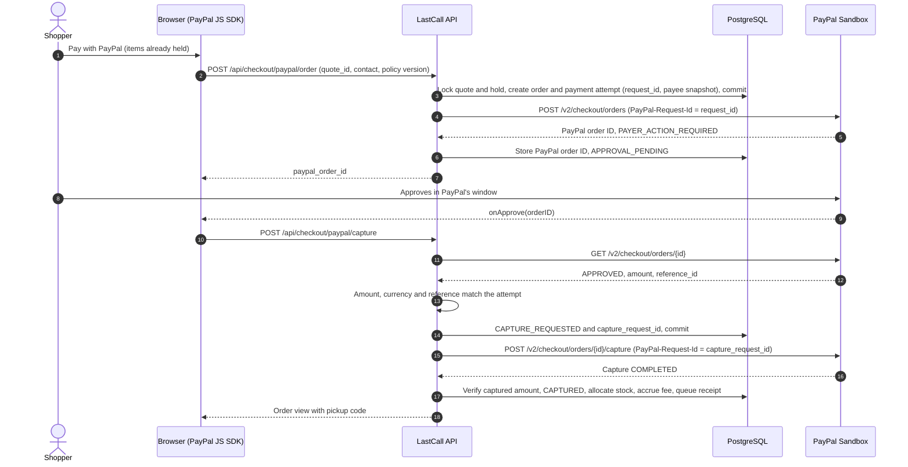
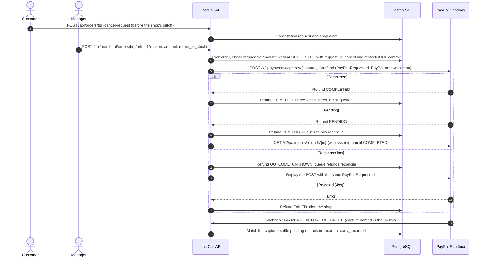
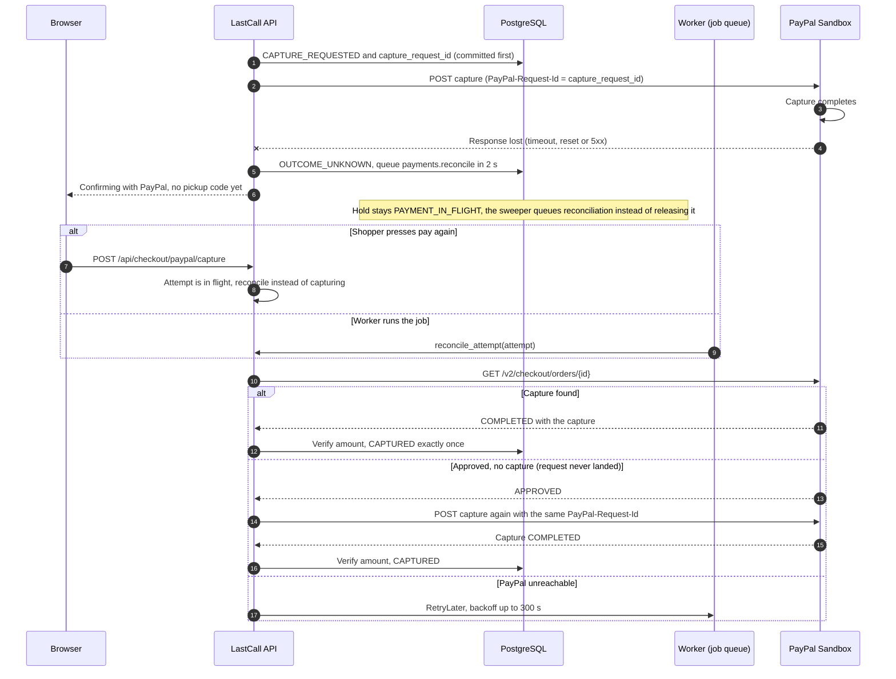
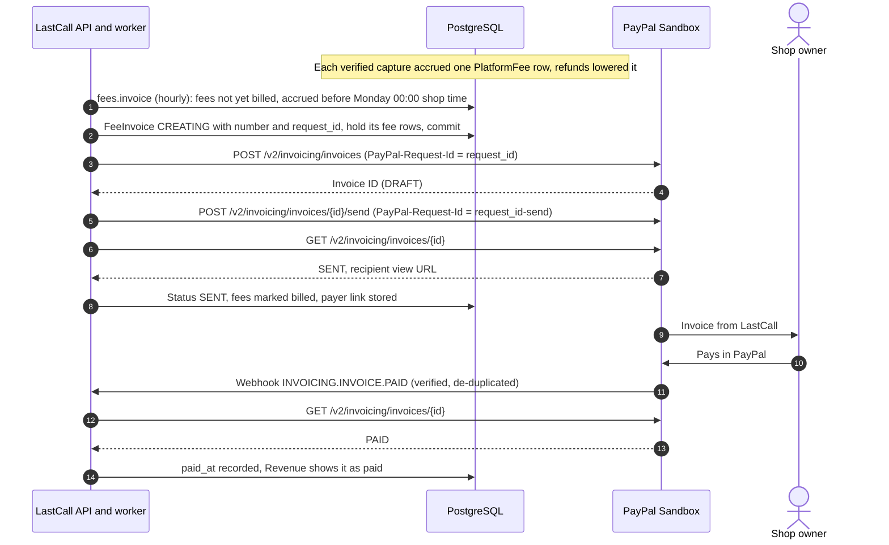

# PayPal integration

LastCall moves every dollar through PayPal. Shoppers pay the shop with **Orders v2**, refunds and live payment lookups use **Payments v2** on the shop's behalf, and LastCall bills its own commission with **Invoicing v2**. Webhooks are verified with PayPal and de-duplicated, and any call whose answer was lost is reconciled against PayPal's record instead of being repeated blindly.

Payments run in the **PayPal Sandbox**. The API host is fixed to `https://api-m.sandbox.paypal.com` in [`backend/app/payments/sandbox.py`](../backend/app/payments/sandbox.py), so test credentials can never move real money (a test asserts this: `test_paypal_client_always_targets_the_sandbox`).

## At a glance

| Capability | PayPal endpoints | What LastCall uses it for |
|---|---|---|
| OAuth 2.0 | `POST /v1/oauth2/token` (client credentials) | Access token for every server call, and the periodic connection check |
| Orders v2 | `POST /v2/checkout/orders`, `GET /v2/checkout/orders/{id}`, `POST /v2/checkout/orders/{id}/capture` | Checkout from LastCall's own quote, approval and amount check, server-side capture, reconciliation, payout-account check |
| Payments v2 | `POST /v2/payments/captures/{id}/refund`, `GET /v2/payments/refunds/{id}`, `GET /v2/payments/captures/{id}` | Refunds, refund reconciliation, live lookups for support replies, all as the shop that was paid |
| Invoicing v2 | `POST /v2/invoicing/invoices`, `POST /v2/invoicing/invoices/{id}/send`, `GET /v2/invoicing/invoices/{id}` | LastCall's weekly platform-fee invoice to each shop |
| Webhooks | `POST /v1/notifications/verify-webhook-signature` | Verifying every incoming event before it is stored |
| Log in with PayPal (optional) | `/connect`, `POST /v1/oauth2/token` (authorization code), `GET /v1/identity/oauth2/userinfo` | "Connect with PayPal" for a shop's payout account |
| JavaScript SDK | `https://www.paypal.com/sdk/js` (Smart Buttons) | Buyer approval in the browser |
| Sandbox negative testing | `PayPal-Mock-Response` header | The `capture_declined` failure drill |

## Client conventions

All server calls go through one client, `SandboxPayPalClient`, wrapped by `FaultInjectingClient` and handed out by `get_client()` ([`backend/app/payments/__init__.py`](../backend/app/payments/__init__.py)).

* **Credentials stay on the server.** Only the public client ID reaches the browser, through `GET /api/config`. Without `PAYPAL_CLIENT_ID` and `PAYPAL_CLIENT_SECRET`, checkout returns `503 paypal_not_configured`, `/api/config` returns `client_id: null` and the checkout page says PayPal isn't connected.
* **Tokens.** The client-credentials token is cached until 60 seconds before it expires and refreshed once if PayPal answers 401.
* **Every money-moving call carries a `PayPal-Request-Id`** (create order, capture, refund, create and send invoice), generated as a UUID and committed to the database before the call. Every call sends `Prefer: return=representation`.
* **Two failure classes** ([`backend/app/payments/base.py`](../backend/app/payments/base.py)):
  * `PayPalError`: PayPal gave a definitive 4xx, so the operation did not happen.
  * `PayPalOutcomeUnknown`: timeout, dropped connection or 5xx. The operation may have happened. Callers record `OUTCOME_UNKNOWN` and reconcile; they never start a new operation.
* **No database transaction is held open across a PayPal call.** State changes are committed first, then PayPal is called, then the result is applied in a new transaction with row locks.
* **Stored responses are trimmed** of payer details (`payer`, `payment_source`, `shipping`, `links`, email addresses, phone numbers) before they are persisted.
* **Metrics:** `lastcall_paypal_calls_total{op, outcome}` (`ok`, `error`, `unknown`) and `lastcall_paypal_latency_seconds{op}` on `/api/metrics`.

### Idempotency keys

| Operation | `PayPal-Request-Id` | Stored on |
|---|---|---|
| Create order | `request_id` | `PaymentAttempt` (unique) |
| Capture order | `capture_request_id` | `PaymentAttempt` (unique) |
| Refund capture | `request_id` | `Refund` (unique) |
| Create invoice | `request_id` | `FeeInvoice` (unique) |
| Send invoice | `<request_id>-send` | derived from the invoice's key |

A retry with the same key returns PayPal's original result, which is why a lost response can be recovered without charging, refunding or billing twice.

## Checkout and capture (Orders v2)

The browser renders PayPal's Smart Buttons ([`frontend/src/components/paypal.tsx`](../frontend/src/components/paypal.tsx)) with `intent=capture`, `commit=true` and `currency=USD`. Both button callbacks call LastCall's server; the browser never sends an amount.

**1. Create the order** (`POST /api/checkout/paypal/order`, [`start_checkout`](../backend/app/services/checkout.py)). In one transaction the API locks the quote and its hold, checks the shop is live, the shopper accepted the current policy version and the quote is still active, then creates the order (`LC-<number>`) and a `PaymentAttempt` with its `request_id` and a snapshot of the shop's payee. The hold becomes `PAYMENT_IN_FLIGHT` and is extended to the shop's payment window (default 900 seconds). After commit, the API creates the PayPal order from the stored quote:

| Field | Value |
|---|---|
| `intent` | `CAPTURE` |
| `purchase_units[0].payee` | `{"merchant_id": <shop's verified merchant ID>}`, omitted when the shop has no connected account |
| `reference_id` / `custom_id` | LastCall order ID / quote ID |
| `invoice_id` | `<order number>-<attempt suffix>`, unique per attempt |
| `amount` + `breakdown` | `item_total`, `tax_total` and, if the shop charges one, `handling`, all from the quote in integer cents |
| `items[]` | One line per product: name, SKU, quantity, unit price, `PHYSICAL_GOODS`, and the regular price in the description |
| `payment_source.paypal.experience_context` | Shop name as `brand_name` (or `PAYPAL_BRAND_NAME` when paying the platform), `NO_SHIPPING`, `PAY_NOW` |

If the shopper presses the button again for the same amount, the existing PayPal order is reused. If the total changed, the old attempt is voided and a new one is created.

**2. Capture** (`POST /api/checkout/paypal/capture`, [`capture`](../backend/app/services/checkout.py)) after the buyer approves:

1. `GET /v2/checkout/orders/{id}` must say `APPROVED`, and its amount, currency and `reference_id` must match the attempt. A mismatch is recorded as `capture_refused_amount_mismatch` and nothing is captured.
2. The attempt is marked `CAPTURE_REQUESTED` with a new `capture_request_id` and committed. A hold that lapsed meanwhile is re-acquired first; if the stock is gone, the shopper is told they were not charged.
3. `POST /v2/checkout/orders/{id}/capture` with that request ID.
4. The capture is applied by `apply_capture_result`, which is idempotent and is the only code that marks an order paid.

| PayPal result | LastCall state | Effect |
|---|---|---|
| Capture `COMPLETED` with the quoted amount | `CAPTURED` | Hold converted to an allocation, quote `CONVERTED`, platform fee accrued, receipt email queued, pickup code shown |
| Capture `PENDING` | `CAPTURE_PENDING` | Reconciliation job in 15 seconds |
| Captured amount differs from the quote | `OUTCOME_UNKNOWN` | High-severity `payment_mismatch` alert, never marked paid |
| Capture `DECLINED`, `FAILED` or similar | `CAPTURE_FAILED` | Hold released |
| `422 INSTRUMENT_DECLINED` | back to `APPROVAL_PENDING` | Browser calls `actions.restart()` so the buyer picks another funding source on the same PayPal order |
| `422 ORDER_ALREADY_CAPTURED` | reconciled | The existing capture is read and applied |
| Other 4xx | `CAPTURE_FAILED` | Shopper told they were not charged |
| Timeout, connection error, 5xx | `OUTCOME_UNKNOWN` | See [Reconciliation](#reconciliation-of-outcome_unknown) |



## Paying each shop directly

**Per-shop payee.** Each `PaymentAttempt` stores the payee that was in force when it was created (`payout_payee()` in [`checkout.py`](../backend/app/services/checkout.py)), and the order names it as `purchase_units[0].payee.merchant_id`. The buyer pays the shop's PayPal business account directly while LastCall's app creates and captures the order. Only a payout account with status `connected` is used. A shop without one is paid into the PayPal app's own account; this is how showcase shops seeded without `SHOWCASE_PAYEE_<SLUG>` work (`test_shop_without_payout_account_is_paid_to_the_platform`).

**Merchant-ID verification** ([`backend/app/services/payouts.py`](../backend/app/services/payouts.py)). The owner enters the 13-character merchant ID from PayPal (Account settings, Business information) under **Settings, Payouts & tax** (`PUT /api/merchant/shop/payouts`, owners only). Before saving, LastCall creates an Orders v2 order for $1.00 with that payee and `reference_id: payout-check`. PayPal rejects an unknown or unusable payee up front (`400`/`422`, for example `PAYEE_ACCOUNT_INVALID`), which LastCall reports as `payee_invalid`. The check order is never approved or captured, so it simply expires and no money moves. Email payees are not accepted, because PayPal accepts any email at order creation and a typo would send money to an unclaimed account. A live shop can switch accounts but cannot remove its payout account (`payout_required`).

**Connect with PayPal (optional, off on the deployed app).** With `PAYPAL_CONNECT_ENABLED=true`, the owner can sign in with PayPal instead of typing the ID:

1. `POST /api/merchant/shop/payouts/paypal/start` returns a Log in with PayPal URL (`https://www.sandbox.paypal.com/connect/`) with scopes `openid email https://uri.paypal.com/services/paypalattributes`, the return URL `<PUBLIC_APP_URL>/merchant/paypal/return`, and a `state` value signed with the server secret that binds the sign-in to this shop and this owner for 10 minutes.
2. PayPal redirects to the return page, which posts `code` and `state` to `POST /api/merchant/shop/payouts/paypal/finish`.
3. The server exchanges the code (`grant_type=authorization_code`), reads `GET /v1/identity/oauth2/userinfo?schema=paypalv1.1`, requires a verified account and a 13-character payer ID, runs the same payee check, then saves it with `connected_via: paypal` and a masked email.

`render.yaml` sets `PAYPAL_CONNECT_ENABLED` to `"false"`, so on the deployed app `/api/config` reports `paypal.connect: false` and owners enter their merchant ID. Setup steps are in [Deployment](deployment.md#paypal-app-setup).

## Acting as the shop: `PayPal-Auth-Assertion`

The money belongs to the shop's account, so refunds and capture or refund lookups must declare that LastCall's app is acting on the shop's behalf. [`backend/app/payments/payee.py`](../backend/app/payments/payee.py) builds the header as an unsigned JWT:

```text
base64url({"alg":"none"}) . base64url({"iss": <PAYPAL_CLIENT_ID>, "payer_id": <shop merchant ID>}) .
```

The payee comes from the **payment attempt's snapshot**, not the shop's current settings, so a refund always goes through the account that was actually paid even if the shop has since switched accounts (`test_refund_uses_the_payee_that_was_actually_paid`). For payments made to the platform account no assertion is sent.

| Call | Assertion |
|---|---|
| `POST /v2/payments/captures/{id}/refund` | Yes, when the attempt has a payee |
| `GET /v2/payments/refunds/{id}` | Yes, when the attempt has a payee |
| `GET /v2/payments/captures/{id}` | Yes, when the attempt has a payee |
| `GET /v2/checkout/orders/{id}` | No (the order was created by LastCall's app) |

## Refunds (Payments v2)

Refunds are reviewed by a manager or owner (`POST /api/merchant/orders/{id}/refund`, staff get `403`), or issued automatically when a shop's no-show policy is `auto_refund` (the `refunds.auto_no_show` job, audited as "Shop policy (automatic)"). Logic is in [`backend/app/services/refunds.py`](../backend/app/services/refunds.py).

* Only an attempt in `CAPTURED` with a capture ID can be refunded, one refund at a time.
* The amount defaults to everything not yet refunded; a partial amount is allowed. Amounts are exact integer cents.
* A full refund before pickup also cancels the order and returns its stock to sale (or writes it off when `return_to_stock` is false). Picked-up items cannot be restocked.
* The request carries its own `PayPal-Request-Id`, the `PayPal-Auth-Assertion` for the paid payee, an `invoice_id` of `<order number>-R-<suffix>` and a `note_to_payer`.
* A refund is **completed only when PayPal says `COMPLETED`**. The refunded amount PayPal reports is compared with the requested amount and a mismatch raises an alert.

| PayPal result | Refund state | Follow-up |
|---|---|---|
| `COMPLETED` | `COMPLETED` | Platform fee recalculated, refund email queued |
| `PENDING` | `PENDING` | `refunds.reconcile` reads `GET /v2/payments/refunds/{id}` (first after 15 seconds) until it settles |
| Timeout, 5xx | `OUTCOME_UNKNOWN` (customer sees pending) | `refunds.reconcile` replays the same POST with the same `PayPal-Request-Id`, which returns the original refund |
| 4xx | `FAILED` | High-severity alert, error shown to the manager |



## Live payment lookups for support replies

When a customer messages the shop from their pickup pass, staff get a template draft at once, and a background agent then drafts a better reply ([`backend/app/services/support.py`](../backend/app/services/support.py)). Its only lookup tool, `check_payment_with_paypal`, reads the live state from PayPal: `GET /v2/checkout/orders/{id}`, then `GET /v2/payments/captures/{id}` and `GET /v2/payments/refunds/{id}` with the `PayPal-Auth-Assertion` of the account that was paid.

* Staff see what PayPal reported under the draft, for example "Paid: $13.50 on Nov 8, 9:02 AM" or "Refund: On its way: $5.00".
* The agent cannot refund, cancel or change anything. Staff review and send every reply.
* The draft may only mention amounts the agent was shown (order total, refunds, and amounts PayPal returned). A sentence with any other amount is dropped from the draft.
* If PayPal can't be reached, the tool returns an error and the agent drafts without stating the payment's live state.

## Reconciliation of `OUTCOME_UNKNOWN`

A capture whose answer never arrived (timeout, reset connection, 5xx) may or may not have charged the buyer. LastCall records `OUTCOME_UNKNOWN`, shows the shopper "Confirming with PayPal" without a pickup code, and resolves it with [`reconcile_attempt`](../backend/app/services/checkout.py). It is safe to run any number of times and is triggered by:

* the `payments.reconcile` job queued 2 seconds after the failure,
* the shopper pressing pay again (an in-flight attempt is reconciled, never captured a second time),
* a capture or order webhook for that payment,
* the `payments.sweep` job every 15 seconds, which queues every attempt in `CAPTURE_REQUESTED`, `OUTCOME_UNKNOWN` or `CAPTURE_PENDING`,
* the **Reconcile** button in Platform ops, Payments.

What it does:

| PayPal's order says | Action |
|---|---|
| A capture exists | Apply it through `apply_capture_result` (amount checked, paid exactly once) |
| `APPROVED`, no capture, and LastCall had requested one | Capture again with the **same** `capture_request_id`. If the first request had landed, PayPal returns its original result. `ORDER_ALREADY_CAPTURED` leads to reading the order and applying the capture. |
| `APPROVED`, capture never requested | Mark `APPROVED`. Abandon only if the hold has expired. |
| `CREATED` or `PAYER_ACTION_REQUIRED` and the hold expired | Abandon: release stock, order `EXPIRED` |
| `VOIDED`, or `404` | Abandon |
| PayPal unreachable | `RetryLater`: the job retries with exponential backoff (up to 300 seconds, 8 attempts) |

**Stock is protected while money is in flight.** The hold sweeper only releases holds in `HELD`. A hold in `PAYMENT_IN_FLIGHT` past its expiry is never released blindly: the payment sweep queues reconciliation instead, and abandonment only happens from pre-capture states (`CREATING`, `APPROVAL_PENDING`, `APPROVED`, `CAPTURE_FAILED`). `test_at09_reservation_expiry_during_payment_processing_protects_paid_order` checks that the last unit stays allocated to the paying buyer through a 40-minute outage.



`test_at07_capture_succeeds_but_response_lost_reconciles_without_double_charge` asserts PayPal saw exactly one capture request and holds exactly one capture after the shopper retried.

## Webhooks

PayPal posts events to `POST /api/webhooks/paypal` on the API ([`backend/app/api/system.py`](../backend/app/api/system.py), handled in [`backend/app/services/webhooks.py`](../backend/app/services/webhooks.py)). The route is exempt from the browser CSRF origin check because PayPal is a server-to-server caller.

1. **Verify.** The raw body is kept byte for byte and spliced into a `POST /v1/notifications/verify-webhook-signature` request with the five transmission headers (`paypal-auth-algo`, `paypal-cert-url`, `paypal-transmission-id`, `paypal-transmission-sig`, `paypal-transmission-time`) and `PAYPAL_WEBHOOK_ID`, so nothing is re-serialized. Only `verification_status: SUCCESS` is accepted. A missing webhook ID or header, or a failed check, returns `400 webhook_rejected`. If PayPal's verification API can't be reached, LastCall returns `503` so PayPal redelivers later.
2. **De-duplicate.** The verified event is inserted into `webhook_events` with `ON CONFLICT (provider_event_id) DO NOTHING`. A repeat increments `duplicate_count` and returns `{"status": "duplicate"}`.
3. **Queue.** A `webhooks.process` job is enqueued (de-duplicated by event ID) and the endpoint returns `{"status": "accepted"}` at once.
4. **Process.** The payload is only a hint about which resource changed. Every state change comes from re-reading the order, refund or invoice from PayPal and applying the same idempotent functions the API uses.

| Event | How LastCall finds its record | What happens |
|---|---|---|
| `CHECKOUT.ORDER.APPROVED` (also `.COMPLETED`) | `resource.id` is the PayPal order ID | `reconcile_attempt`: marks the attempt `APPROVED`, or applies a capture if one exists. It captures only when the shopper's capture was already requested, retrying with the same `capture_request_id`. |
| `PAYMENT.CAPTURE.COMPLETED` | `resource.id` is the capture ID, else `supplementary_data.related_ids.order_id` | `reconcile_attempt`: paid exactly once (a replay changes nothing) |
| `PAYMENT.CAPTURE.PENDING` | as above | `CAPTURE_PENDING`, reconciled until it settles |
| `PAYMENT.CAPTURE.DENIED` (also `.DECLINED`) | as above | `CAPTURE_FAILED`, hold released |
| `PAYMENT.CAPTURE.REFUNDED`, `PAYMENT.CAPTURE.REVERSED` | The resource is the **refund**, so its ID is not a capture ID. The capture comes from `related_ids.capture_id` or, as PayPal sends it, from the refund's **`up` link** (`.../v2/payments/captures/{capture_id}`). | Each pending LastCall refund on that capture is reconciled. A refund LastCall already completed is recorded as `already_recorded`. Anything else (for example a refund made in PayPal's dashboard) raises a high-severity `external_refund` alert for the shop. |
| `INVOICING.INVOICE.PAID`, `INVOICING.INVOICE.CANCELLED` (any `INVOICING.INVOICE.*`) | `resource.id` is the PayPal invoice ID | `fees.sync` re-reads the invoice: `PAID` records payment, `CANCELLED` puts its fees back to be billed |
| Anything unmatched | | Stored with result `unmatched` |

Each stored event keeps its payload, raw body, transmission headers, duplicate count and a processing result such as `reconciled:captured`, `refunds:already_recorded` or `fee_invoice:PAID`, shown in **Platform ops, Webhooks**. `POST /api/ops/webhooks/{id}/replay` re-submits a stored event through the same receiver; because its event ID is already recorded it comes back as `duplicate` (asserted in AT-08).

Capture results never depend on webhooks: the capture response and the reconciler are authoritative, so checkout works locally where PayPal can't reach the API.

## Platform fees (Invoicing v2)

Shoppers pay the shop's price and nothing more, straight to the shop. LastCall's revenue is a commission billed to each shop afterwards with a PayPal invoice ([`backend/app/services/fees.py`](../backend/app/services/fees.py), [`backend/app/models/fees.py`](../backend/app/models/fees.py)). Taking the fee inside the payment would need PayPal partner onboarding, so it is invoiced weekly instead.

**Terms.** `PLATFORM_FEE_BPS` (default `1000`, 10%) of the order's items at their surplus price, at least `PLATFORM_FEE_MIN_MINOR` (default `25`, $0.25), never more than the items themselves. Half a cent rounds up. Each order keeps the terms it was paid under.

| Items | Fee |
|---|---|
| $5.00 | $0.50 |
| $1.50 | $0.25 (minimum) |
| $0.20 | $0.20 (capped at the items) |
| $10.05 | $1.01 |

**Lifecycle.**

* **Accrued on capture.** `apply_capture_result` calls `fees.accrue` when PayPal confirms the capture. One `PlatformFee` row per order (unique), so a replayed capture or webhook changes nothing.
* **Reduced by refunds.** When a refund completes, the fee is recalculated on the items in proportion to the money the shop kept. A full refund waives it. If the fee was already invoiced, the difference is taken off the next invoice as a discount.
* **Billed weekly.** The `fees.invoice` job runs every hour and bills each shop for fees accrued before Monday 00:00 in the shop's time zone, so last week's fees go out early on Monday. Platform ops can also bill everything due now (**Revenue, Bill shops now**, `POST /api/ops/fees/invoice-now`).
* **One invoice per shop.** Invoice number `LCF-<shop>-<sequence>-<random>` (numbers are unique across the whole PayPal account), invoicer "LastCall", recipient the shop owner's account email (else the shop's support email), `payment_term: NET_15`, one item per order (name "Order LC-1042", description "Nov 3: 10% of $5.00 items" or "Nov 3: minimum fee"; grouped per day above 100 lines), and earlier over-billing as an `invoice_discount`. If credits outweigh charges, the invoice waits for more charges.
* **Sent and tracked.** After `create` and `send` (to the recipient only), LastCall reads the invoice back; fees count as billed once PayPal reports it sent, and the payer link is stored. Payment is recorded from `INVOICING.INVOICE.*` webhooks, with the `fees.sync` job every 15 minutes as the fallback. `PAID` or `MARKED_AS_PAID` sets `paid_at`.
* **Failures put fees back.** A PayPal 4xx marks the invoice `FAILED` and a cancelled invoice is marked `CANCELLED`; in both cases its fees return to be billed again. A lost response leaves the invoice in `SENDING`, and the status check settles it once it has a PayPal invoice ID.

Shops see the fee and what they keep on every order ("LastCall fee, You keep, Invoiced") and their invoices with a **Pay in PayPal** link under **Settings, Payouts & tax**. **Platform ops, Revenue** shows fees in the last 7 days, not yet billed, invoiced and unpaid, and paid.



## Failure-injection drill

Platform admins can arm a PayPal failure for the next capture to watch LastCall recover without charging twice ([`backend/app/payments/faults.py`](../backend/app/payments/faults.py)). It needs `OPS_FAULTS_ENABLED=true`, which `render.yaml` sets on the deployed API. Armed faults live in the database (`fault_injections`, one row per arming with a remaining count of 1 to 5, consumed with `FOR UPDATE SKIP LOCKED`), so they work across processes. The wrapper changes nothing unless a fault is armed.

| Fault | What is simulated | What you should see |
|---|---|---|
| `capture_response_lost` | The capture really happens at PayPal, then the response is dropped | Pickup pass shows "Confirming with PayPal", then the reconciler finds the capture and the order is paid. PayPal holds exactly one capture. |
| `capture_timeout` | The capture request times out before it reaches PayPal | `OUTCOME_UNKNOWN`, then the reconciler sees `APPROVED` with no capture and captures with the same `capture_request_id` |
| `capture_declined` | The buyer's funding instrument is declined, using Sandbox negative testing (`PayPal-Mock-Response: {"mock_application_codes": "INSTRUMENT_DECLINED"}`) | "Your payment method was declined", and PayPal's window reopens on the same order to choose another way to pay |

To run it:

1. Sign in as a platform admin, open **Platform ops, Failure injection**, and press **Arm once** next to a fault.
2. As a shopper, place and pay for an order.
3. In **Platform ops, Payments**, find the order: its state, PayPal order and capture IDs, payee and a reconcile count. **Trace** lists the audit events in order, for example `capture_requested`, `capture_outcome_unknown`, `capture_verified`.
4. **Disarm all** clears anything left armed.

`test_failure_injection_is_off_unless_enabled` and the AT-07 and AT-09 tests run these faults against the PayPal stand-in.

## Where it lives

| Capability | Files |
|---|---|
| PayPal REST client: OAuth, Orders v2, Payments v2, Invoicing v2, webhook verification, Log in with PayPal | [`backend/app/payments/sandbox.py`](../backend/app/payments/sandbox.py) |
| Client contract, error classes, capture helpers, PII trimming | [`backend/app/payments/base.py`](../backend/app/payments/base.py) |
| Client factory and credentials check | [`backend/app/payments/__init__.py`](../backend/app/payments/__init__.py) |
| Per-shop payee and `PayPal-Auth-Assertion` | [`backend/app/payments/payee.py`](../backend/app/payments/payee.py) |
| Failure injection | [`backend/app/payments/faults.py`](../backend/app/payments/faults.py), [`backend/app/api/ops.py`](../backend/app/api/ops.py), [`frontend/src/app/ops/ops.tsx`](../frontend/src/app/ops/ops.tsx) |
| Checkout, capture, reconciliation, payment sweeps | [`backend/app/services/checkout.py`](../backend/app/services/checkout.py), [`backend/app/api/checkout.py`](../backend/app/api/checkout.py) |
| Smart Buttons and the checkout page | [`frontend/src/components/paypal.tsx`](../frontend/src/components/paypal.tsx), [`frontend/src/app/checkout/[quoteId]/checkout.tsx`](../frontend/src/app/checkout/%5BquoteId%5D/checkout.tsx) |
| Refunds and no-show refunds | [`backend/app/services/refunds.py`](../backend/app/services/refunds.py), [`backend/app/api/merchant_orders.py`](../backend/app/api/merchant_orders.py) |
| Platform fees and weekly invoices | [`backend/app/services/fees.py`](../backend/app/services/fees.py), [`backend/app/models/fees.py`](../backend/app/models/fees.py) |
| Webhooks | [`backend/app/services/webhooks.py`](../backend/app/services/webhooks.py), [`backend/app/api/system.py`](../backend/app/api/system.py) |
| Payout accounts: merchant-ID check, Connect with PayPal | [`backend/app/services/payouts.py`](../backend/app/services/payouts.py), [`backend/app/api/shops.py`](../backend/app/api/shops.py), [`frontend/src/app/merchant/settings/sections.tsx`](../frontend/src/app/merchant/settings/sections.tsx), [`frontend/src/app/merchant/paypal/return/paypal-return.tsx`](../frontend/src/app/merchant/paypal/return/paypal-return.tsx) |
| Support agent's live PayPal lookups | [`backend/app/services/support.py`](../backend/app/services/support.py) |
| Connection check (`paypal.check`, every 30 minutes) | [`backend/app/services/overview.py`](../backend/app/services/overview.py) |
| Payment, refund, webhook and fault tables | [`backend/app/models/orders.py`](../backend/app/models/orders.py) |
| Tests and the PayPal stand-in | [`backend/tests/test_checkout.py`](../backend/tests/test_checkout.py), [`test_fees.py`](../backend/tests/test_fees.py), [`test_payouts.py`](../backend/tests/test_payouts.py), [`test_support.py`](../backend/tests/test_support.py), [`test_ops.py`](../backend/tests/test_ops.py), [`fake_paypal.py`](../backend/tests/fake_paypal.py) |
